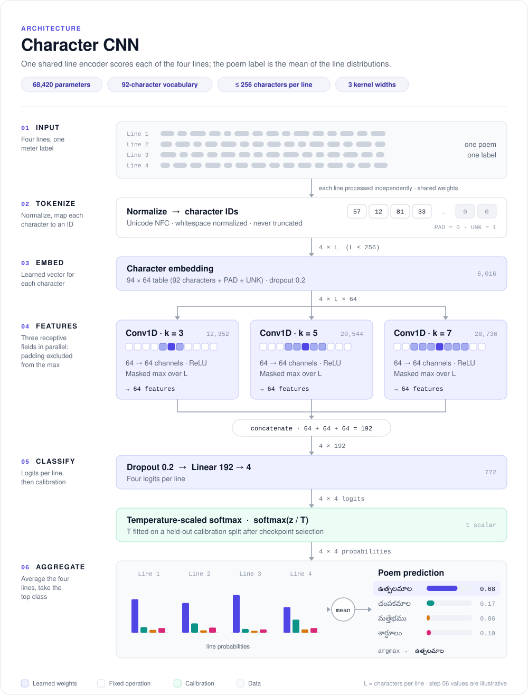
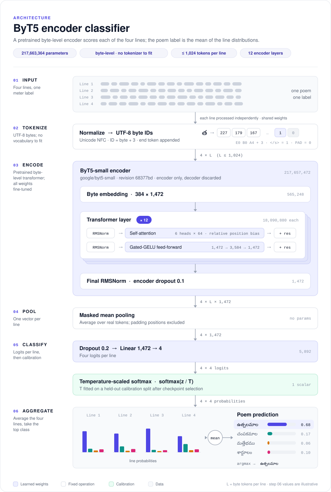

# Chandassu Recognition

Chandassu Recognition identifies four Telugu poetic meters:
**ఉత్పలమాల · చంపకమాల · మత్తేభము · శార్దూలం**.

The project provides a character CNN and a ByT5 encoder classifier.
The published v1 models were trained on an **NVIDIA H100 NVL**.
The expanded CNN corpus is ready for GX10 training; ByT5 remains unchanged.
Use the CNN when you need a smaller model.
You can train several models with different seeds and hyperparameters.
You can then use those models together as an ensemble.

Download the final model packages from [Hugging Face](https://huggingface.co/sprx7767/chandassu-recognition).

Each poem has four lines and one meter label.
The model calculates class probabilities for each line.
It then calculates the mean of those probabilities to identify the poem's meter.

## Install

Install Python 3.12 and [uv](https://docs.astral.sh/uv/).
Run these commands from the project directory:

```bash
uv sync --locked --extra cpu
source .venv/bin/activate
```

For an x86-64 Linux system with CUDA 12.8, use this installation command instead:

```bash
uv sync --locked --extra cuda
source .venv/bin/activate
```

The first ByT5 training run downloads the base model.
CNN training does not require a model download.

## Train a model

Run one of these commands:

```bash
python train.py --model_type=cnn --config=configs/cnn.json --output_dir=runs/cnn-v2-combined
python train.py --model_type=byt5
```

Each command trains one model with the final model hyperparameters.
The CNN preset uses v1 plus the new v2 fitting works and retains the original validation/calibration.
ByT5 uses the original v1 partitions. Both keep all test works out of training and selection.
The script prints the settings before training starts.

### Change the settings

Set the seed, learning rate, batch size, and epoch limit with command-line options:

```bash
python train.py --model_type=cnn --seed=42 --learning_rate=0.0002 \
  --microbatch_poems=8 --effective_batch_poems=16 \
  --epochs=80 --minimum_epochs=24 --output_dir=runs/cnn-seed42

python train.py --model_type=byt5 --microbatch_poems=4 \
  --effective_batch_poems=16 --gradient_checkpointing \
  --output_dir=runs/byt5-checkpointed
```

You can also change [configs/cnn.json](configs/cnn.json) or [configs/byt5.json](configs/byt5.json).
Command-line options override the configuration file.
Use `python train.py --help` to list all options.

Batch sizes count poems.
Each poem supplies four lines.
The microbatch size is the number of poems processed at one time.
The effective batch size is the number of poems used for one weight update.
The effective batch size must be a multiple of the microbatch size.

### Train an ensemble

Train each model separately with its own seed and output directory.
You can also change the hyperparameters for each model:

```bash
python train.py --model_type=cnn --seed=17 --learning_rate=0.0001 \
  --output_dir=runs/cnn-seed-17

python train.py --model_type=cnn --seed=42 --learning_rate=0.0002 \
  --output_dir=runs/cnn-seed-42
```

Use distinct seeds and the same model type for all ensemble members.
Load the completed model packages together:

```bash
python inference.py --model_dirs runs/cnn-seed-17/model runs/cnn-seed-42/model \
  --strategy=ensemble --port=8765
```

### Save and resume training

The script saves these files in the output directory:

| File | Contents |
|---|---|
| `best.pt` | Checkpoint with the highest validation poem Macro F1 |
| `last.pt` | Last completed epoch, weights, optimizer, scheduler, and random states |
| `history.json`, `history.csv` | Loss, F1, learning rate, and duration for each epoch |
| `model/` | Model package for inference |
| `run.json`, `partitions.json` | Training settings and poem assignments |
| `result.json` | Final validation and calibration results |

To resume a run, use the same settings and output directory.
Add `--resume` to the original command:

```bash
python train.py --model_type=cnn --resume
```

Training starts from the last completed epoch.
The script checks that the data, settings, code, and software versions have not changed.

To train an existing model on additional data, use a new output directory:

```bash
python train.py --model_type=cnn --data_dir=/path/to/prepared/data \
  --init_checkpoint=/path/to/stored/models/cnn --output_dir=runs/cnn-more-data
```

This command keeps the model's architecture and input encoding.
It starts a new optimizer.
A CNN maps new characters to its unknown-character token.
Train a new CNN to add characters to its vocabulary.
See [data/README.md](data/README.md) for data preparation instructions.

### Cross-validation

To train three models with separate validation groups, run this command:

```bash
python train.py --model_type=cnn --mode=cross_validate --folds=3 \
  --split_manifest=none --calibration_fraction=0 --split_seed=142 \
  --output_dir=runs/cnn-cv
```

Each fold uses the supplied settings.
The script keeps works together and uses only training and validation data.
This procedure differs from the original experiment.
Its scores are validation scores for the selected checkpoints.

## Data and sources

The poems come from [AndhraBharati](https://andhrabharati.com/) and [Telugu Wikisource](https://te.wikisource.org/).
The combined four-class dataset in `data/v2` contains **13,295 poems** and **53,180 lines** from **70 distinct works**.
V2 already includes v1; do not concatenate them.

| Dataset | Poems | Lines | Works |
|---|---:|---:|---:|
| Training, including calibration | 8,483 | 33,932 | 53 |
| Validation | 1,859 | 7,436 | 4 |
| Holdout test | 2,953 | 11,812 | 13 |
| **Total** | **13,295** | **53,180** | **70** |

The expanded CNN uses **7,575 poems** (**30,300 lines**) to update model weights: all
6,517 original fitting poems plus 1,058 new poems from 27 works. Validation is unchanged.
A separate set of **908 poems**, or **3,632 lines**, adjusts the output probabilities through temperature calibration.
These 908 poems come from the training dataset shown above.

Validation scores determine which checkpoint to save.
Calibration adjusts the probabilities after checkpoint selection.
The single test file contains the original 2,234 test poems plus 719 poems from seven
new works frozen before the GX10 trial. None enter training, vocabulary fitting,
validation or calibration. Both cohorts were previously evaluated on earlier models;
this is a fixed benchmark, not a fresh blind study. The evaluation script reports
the combined score and each cohort separately.

The completed GX10 trial already used this exact fitting/validation/calibration set.
Retraining is a fresh run on the same examples; growth is relative to the v1 baseline.
The published CNN/ByT5 results below remain v1 results until the new CNN is reviewed.
See [data/v2/WORKS.md](data/v2/WORKS.md) for the new work assignments.

All four lines of a poem stay in the same dataset.
A work and its related editions stay together.
Works with duplicate lines also stay together, including duplicates with different spacing.
Some authors occur in more than one dataset.

[data/v1/WORKS.md](data/v1/WORKS.md) describes the larger collection of **46 works**.
It includes authors, source links, poem counts, and additional data excluded from the four-class dataset.
Poems from other classes and poems without a known class are excluded from model training.

### Expanded trial compared with the released baseline

CPU inference evaluated both native CNN packages on exactly the same poems.
Validation remains checkpoint-selected; the test cohorts were already inspected on earlier models.

| Poem Macro F1 | Released v1 CNN | Returned GX10 expanded trial |
|---|---:|---:|
| Validation (1,859 poems) | 0.998596 | 0.998596 |
| Original test (2,234 poems) | 1.000000 | 1.000000 |
| New-work test (719 poems) | 0.996042 | 0.996042 |
| Combined test (2,953 poems) | 0.999084 | 0.999084 |

Both models make the same three validation errors and the same three test errors.
This trial shows no poem-level improvement over the released baseline. New-work line
Macro F1 improves from 0.987509 to 0.988885; combined-test line Macro F1 decreases from
0.992608 to 0.992291. The larger corpus does not establish an overall accuracy gain. Hardware/runtime
and vocabulary differ, so this is an artifact comparison rather than a controlled causal study.
The reviewed trial is not the published CNN; the fresh combined run is still pending.
Its fit, validation and calibration assignments equal this trial's assignments.
Baseline native weights SHA-256: `6d8d642f8b83343e6e98c90365b1449acf0fcedf430f4b4e727a01979aa4e95e`.
Trial native weights SHA-256: `e2f0d7a084fe16dfda6dd95a6edd845fff99d1d105aef89056ce5d66b5ffffa0`.
The detailed local comparison is preserved in ignored `runs/review-gx10-v2/baseline-comparison.json`.

## Model architectures

### Character CNN



The published v1 CNN has **68,420 parameters** with the **92-character vocabulary** built from its training poems.
The embedding table adds padding and unknown-character tokens, for 94 tokens in total.
Three convolution branches process each line with different kernel sizes.
Each branch supplies 64 features to the classification layer.

### ByT5 encoder



The ByT5 encoder and classification layer have **217,663,364 parameters**.
The model converts each line to UTF-8 byte tokens.
The encoder produces token features, and the classification layer predicts one of four meters.

The base model is [`google/byt5-small`](https://huggingface.co/google/byt5-small).
The configuration specifies revision `68377bdc18a2ffec8a0533fef03b1c513a4dd49d`.

### Training hyperparameters

| Setting | CNN | ByT5 |
|---|---:|---:|
| Initial learning rate | 0.0001 | 0.00003 |
| Microbatch size, poems | 16 | 8 |
| Effective batch size, poems | 16 | 16 |
| Evaluation batch size, poems | 16 | 8 |
| Maximum epochs | 60 | 32 |
| Minimum epochs | 24 | 8 |
| Early stopping: epochs without improvement | 12 | 8 |
| Input limit per line | 256 characters | 1,024 byte tokens, including the end token |
| Gradient checkpointing | Off | Off |
| Selected epoch for seed 17 | 59 | 17 |

Both models use the following settings:

| Setting | Value |
|---|---|
| Optimizer | AdamW |
| Weight decay | 0.01 |
| Dropout | 0.2 |
| Gradient clipping | 1.0 |
| Learning-rate scheduler | ReduceLROnPlateau |
| Scheduler input | Validation line cross-entropy loss, without class weights |
| Scheduler patience | 4 epochs |
| Learning-rate multiplier | 0.5 |
| Minimum learning rate | 0.000001 |
| Minimum F1 improvement | 0.000001 |
| Minimum loss improvement for an F1 tie | 0.0001 |
| Random seeds | 17, 42, 73 |
| Poem order | Fixed |

The scheduler reduces the learning rate when validation loss stops improving.
Validation poem Macro F1 determines the best checkpoint.
For an F1 tie, lower validation line loss determines the checkpoint.
All training settings are available as command-line options.

## Results

[results/v1](results/v1) contains the final results for all three folds and all six final models.
It includes training histories, class scores, work scores, tables, and figures.

| Measure | CNN | ByT5 |
|---|---:|---:|
| Cross-validation poem Macro F1, mean across seeds | 0.997130 | 0.997137 |
| Correct historical test poems, for each seed | 2,234 / 2,234 | 2,233 / 2,234 |
| Historical test poem Macro F1 | 1.000000 | 0.999619 |

The cross-validation row reports scores for poems with meter labels supplied by the sources.
Macro F1 gives equal weight to each of the four classes.
The two models had similar scores within the experiment's comparison margin of 0.002 F1.
The CNN is smaller and costs less to run.

The historical test poems had been examined during earlier project work.
These scores therefore describe performance on known test data.
They do not establish performance on a new, independent test set.
The labels combine source annotations and rule-based checks.
Independent experts have not verified every label.

Both models can assign high probabilities to poems from other meters.
Use them to classify the four listed meters.
The reported probabilities are not statistical confidence intervals.
The models do not produce syllable divisions, Guru/Laghu patterns, or gaṇa sequences.

## Inference

The web interface accepts a single line or a four-line poem.
It displays the predicted meter, class probabilities, and line predictions.
You can select a single model or an ensemble.
You can also switch between light and dark themes.

### Load in Python without cloning this project

Install the tested dependencies in your Python environment:

```bash
pip install "torch==2.8.0" "transformers==4.57.6" "safetensors==0.8.0"
```

Use the Transformers Auto interfaces to load the tokenizer and classifier.
The tokenizer applies the same text normalization and input encoding used in training.
The model returns four raw logits for each line.
Apply the saved calibration temperature, then average line probabilities to classify a poem.

```python
import torch
from transformers import AutoModelForSequenceClassification, AutoTokenizer

repo = "sprx7767/chandassu-recognition"
options = {"subfolder": "cnn", "trust_remote_code": True}
# Change "cnn" to "byt5" to load the ByT5 encoder classifier.
tokenizer = AutoTokenizer.from_pretrained(repo, **options)
model = AutoModelForSequenceClassification.from_pretrained(repo, **options).eval()

poem = """శ్రీ కైవల్య పదంబుఁ జేరుటకునై చింతించెదన్ లోక ర
క్షైకారంభకు, భక్త పాలన కళా సంరంభకున్, దానవో
ద్రేకస్తంభకుఁ, గేళి లోల విలసద్దృగ్జాల సంభూత నా
నా కంజాత భవాండ కుంభకు, మహానందాంగనాడింభకున్."""
lines = [line.strip() for line in poem.splitlines() if line.strip()]
if len(lines) not in (1, 4):
    raise ValueError("Supply one line or a four-line poem")
inputs = tokenizer(lines, padding=True, return_tensors="pt")
with torch.inference_mode():
    logits = model(**inputs).logits
    line_scores = (logits.double() / model.config.calibration_temperature).softmax(dim=-1)
    scores = line_scores.mean(dim=0)

winner = scores.argmax().item()
print(model.config.id2label[winner], f"{scores[winner].item():.2%}")
for index, score in enumerate(scores):
    print(model.config.id2label[index], f"{score.item():.2%}")
```

`AutoModel.from_pretrained(repo, **options)` also loads this classifier.
`trust_remote_code=True` loads the Python classes supplied in the model repository.
For a fixed model version, add `"revision": "<full commit ID>"` to `options`.
The example was tested with Python 3.12 and the dependency versions listed above.
Input limits are 256 characters per line for CNN and 1,024 byte tokens, including the end token, for ByT5.
The tokenizer rejects overlong input and does not truncate lines.

Class probabilities are calibrated scores, not statistical confidence intervals.
A standard text-classification pipeline applies its own softmax to line logits.
Use the calculation above for calibrated poem scores.
Clone this project when you need the web interface, ensembles, or training.

### Download trained models

Download the final CNN or ByT5 package from [Hugging Face](https://huggingface.co/sprx7767/chandassu-recognition).
Run these commands from the project directory with its Python environment active.

For CNN:

```bash
hf download sprx7767/chandassu-recognition \
  --include 'cnn/*' --local-dir models/hf

python inference.py --model_dir=models/hf/cnn --strategy=single --port=8765
```

For ByT5:

```bash
hf download sprx7767/chandassu-recognition \
  --include 'byt5/*' --local-dir models/hf

python inference.py --model_dir=models/hf/byt5 --strategy=single --port=8765
```

Open [http://127.0.0.1:8765](http://127.0.0.1:8765).

### Export a local checkpoint

Replace `/path/to/stored/models` with the directory that contains your saved training bundle.
Export the required model:

```bash
python scripts/export_model.py --bundle /path/to/stored/models \
  --model_type=cnn --seed=17 --output_dir=models/cnn

python scripts/export_model.py --bundle /path/to/stored/models \
  --model_type=byt5 --seed=17 --output_dir=models/byt5
```

These export commands expect the completed training bundle format.
For a new training run, use its `model/` directory directly.
To add Transformers Auto loaders to a local package, run:

```bash
python scripts/export_hf.py --model_dir=/path/to/model/package \
  --output_dir=/path/to/transformers/package
```

This command preserves the weights and adds the tokenizer, classifier code, and Auto mappings.
Use a separate, empty output directory.
The exported package also works with `inference.py`.
For a Hub repository with model subdirectories, use `--hub_dir=/path/to/hub/root` to stage the shared code and model card.

Start the server with a model package:

```bash
python inference.py --model_dir=/path/to/model/package --strategy=single --port=8765
```

Open [http://127.0.0.1:8765](http://127.0.0.1:8765).
Use `models/cnn` or `models/byt5` as the model directory for the exports above.

### Load an ensemble

Export a separate package for each seed:

```bash
for seed in 17 42 73; do
  python scripts/export_model.py --bundle /path/to/stored/models \
    --model_type=cnn --seed="$seed" --output_dir="models/cnn-seed-$seed"
done
```

Start the server with all three packages:

```bash
python inference.py \
  --model_dirs models/cnn-seed-17 models/cnn-seed-42 models/cnn-seed-73 \
  --strategy=ensemble --port=8765
```

The ensemble calculates the mean of the models' calibrated class probabilities.
Use at least two different seeds from the same model type.
Use `--strategy=single` to make the first package the default model.
The interface can switch between loaded models without a server restart.
The same commands support ByT5 packages.

The displayed score range compares the loaded models.
It is not a confidence interval.
The server evaluates all loaded models to calculate that range.
Load one package to reduce inference time.

### Use the API

| Endpoint | Purpose |
|---|---|
| `GET /health` | Server status |
| `GET /api/info` | Model details |
| `POST /api/predict` | Meter prediction |

Submit a four-line poem in a JSON request:

```bash
curl http://127.0.0.1:8765/api/predict \
  -H 'Content-Type: application/json' \
  -d '{"text":"line one\nline two\nline three\nline four","strategy":"ensemble"}'
```

Use `"single"`, `"ensemble"`, or a loaded seed such as `"seed-42"` for the strategy.
Omit the strategy to use the server default.

The response includes class probabilities, line logits, line agreement, probability margin, entropy, temperature, and inference time.
CNN responses also include the fraction of unknown characters.
The server returns HTTP 422 for unsupported line counts or inputs above the model's length limit.

## Run with Docker

### Inference on CPU

Build the image:

```bash
docker build --target cpu -t chandassu:cpu .
```

Replace `/absolute/path/to/model/package` with the directory of one exported model.
Start the server:

```bash
docker run --rm -p 127.0.0.1:8765:8765 \
  -v /absolute/path/to/model/package:/app/models/current:ro \
  chandassu:cpu python inference.py --host=0.0.0.0 \
  --model_dir=/app/models/current --strategy=single --port=8765
```

Open [http://127.0.0.1:8765](http://127.0.0.1:8765).

### CNN training on GX10 / GB10

From a fresh clone, use the existing Dockerfile's GX10 target with Docker and GPU access enabled:

```bash
docker build --platform=linux/arm64 --target=gx10 -t chandassu:gx10 .
docker run --rm --gpus all --ipc=host --user "$(id -u):$(id -g)" \
  -e USER="$(id -un)" -e LOGNAME="$(id -un)" \
  -v "$PWD:/app" -w /app chandassu:gx10
```

The default command trains a fresh CNN with `configs/cnn.json` on the combined `data/v2`
partitions and writes `runs/cnn-v2-combined`. It prints all partition counts before fitting.
The target retains NVIDIA PyTorch/CUDA from `nvcr.io/nvidia/pytorch:25.11-py3`, the base
used in the successful GX10 trial. Application dependencies use the pyproject pins in
an isolated environment. USER/LOGNAME and a writable cache address the previous UID error.
This ARM64 target replaces the x86 CUDA wheel installation on GX10. It has not been
built locally because the local Docker daemon is stopped; the original GPU base was
verified by the completed GX10 trial. Runtime versions are recorded with the run.

After training, evaluate the frozen test set:

```bash
docker run --rm --gpus all --ipc=host --user "$(id -u):$(id -g)" \
  -e USER="$(id -un)" -e LOGNAME="$(id -un)" \
  -v "$PWD:/app" -w /app chandassu:gx10 \
  python scripts/evaluate.py --model_dir=runs/cnn-v2-combined/model \
  --data_dir=data/v2 --output=runs/cnn-v2-combined/test.json
tar -czf runs/gx10-cnn-v2-combined.tar.gz runs/cnn-v2-combined
```

Resume an interrupted run by repeating the Docker command with an explicit command:
`python train.py --model_type=cnn --config=configs/cnn.json --output_dir=runs/cnn-v2-combined --device=cuda --precision=bf16 --resume`.
Use validation poem Macro F1 for checkpoint selection; test scores never choose settings.
The new model and CNN-only model card update remain pending until the returned run is reviewed.

### Training on a CUDA GPU

Use an x86-64 Linux host with an NVIDIA GPU and NVIDIA Container Toolkit.
Build the image:

```bash
docker build --target cuda -t chandassu:cuda .
```

Create the output directory:

```bash
mkdir -p runs
```

Start training:

```bash
docker run --rm --gpus all --user "$(id -u):$(id -g)" \
  -v "$PWD/runs:/app/runs" -e HF_HOME=/app/runs/huggingface \
  chandassu:cuda python train.py --model_type=byt5 \
  --device=cuda --precision=bf16 --output_dir=/app/runs/byt5
```

Use `--model_type=cnn` to train the CNN.
The container writes checkpoints and the model package to the mounted output directory.

## License and citation

You may use, modify, and share the project code and project-owned dataset annotations under [LICENSE](LICENSE).
**You must cite Chandassu Recognition when you use either the code or the dataset.**

Include the citation in publications and reports.
For other uses, keep the citation in the application or dataset documentation.
Preserve the original poem authors and source links when you share data.

Third-party poems and source editions retain their own terms; see [data/LICENSE.md](data/LICENSE.md).
Earlier Apache-2.0 releases retain their original permissions.

Use this BibTeX entry:

```bibtex
@misc{pranav2026chandassu,
  author = {Pranav Surampudi},
  title = {Chandassu Recognition: Telugu Poetic Meter Classification},
  year = {2026},
  howpublished = {\url{https://github.com/Pranav-20186017/chandassu_recognition}},
  note = {Code, dataset annotations, and trained-model results}
}
```

[CITATION.cff](CITATION.cff) supplies the same citation for GitHub and citation tools.
Record the version or commit used in your work.
