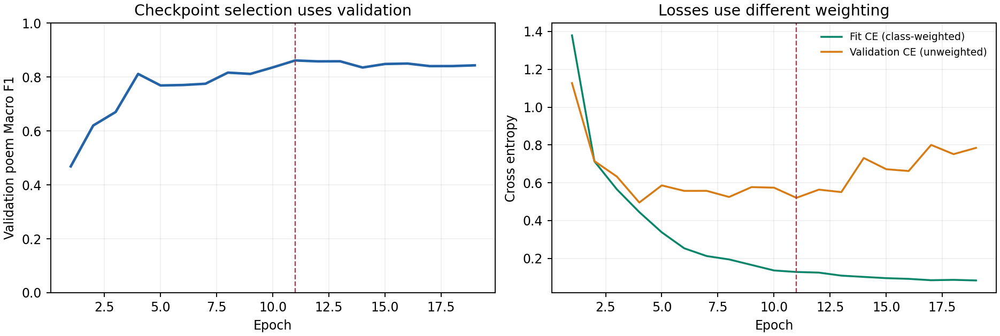
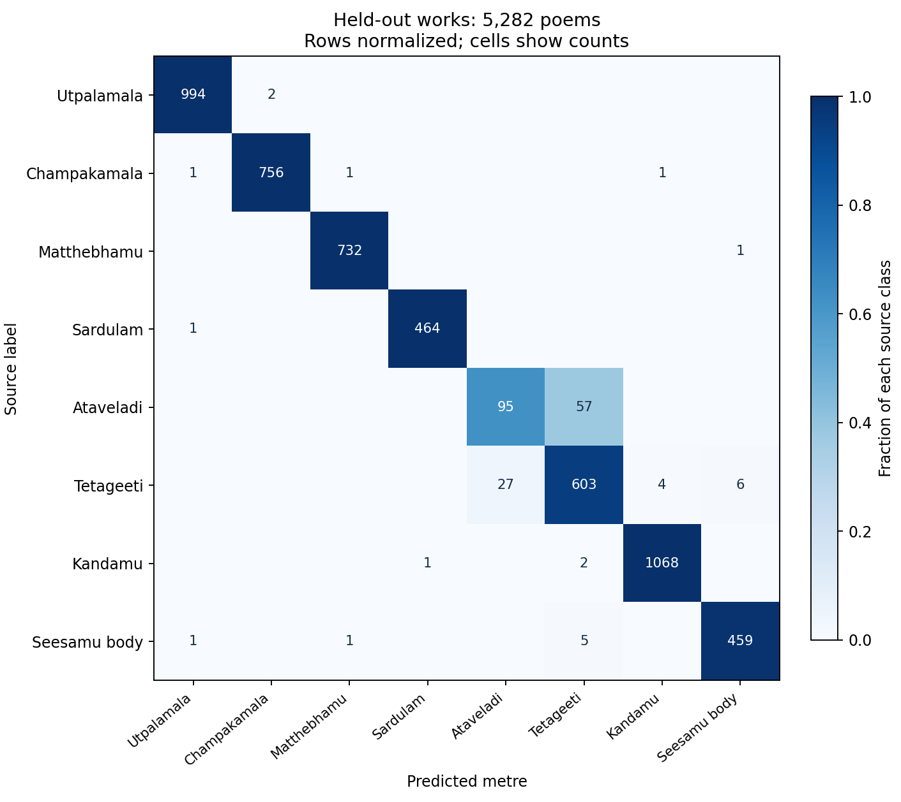

# Eight-class CNN: completed local experiment

Fresh seed-17 ordered poem CNN, selected at epoch **11** after 19 epochs on CPU/fp32. Test poem **Macro F1 94.8425%**, **accuracy 97.8985%** (5,282 poems).

Checkpoint-selected validation Macro F1: 86.1444%. Test did not choose the checkpoint, labels, split, LR schedule or recipe.

| Class | Precision | Recall | F1 | Test poems |
|---|---:|---:|---:|---:|
| ఉత్పలమాల | 99.70% | 99.80% | 99.75% | 996 |
| చంపకమాల | 99.74% | 99.60% | 99.67% | 759 |
| మత్తేభము | 99.73% | 99.86% | 99.80% | 733 |
| శార్దూలం | 99.78% | 99.78% | 99.78% | 465 |
| ఆటవెలది | 77.87% | 62.50% | 69.34% | 152 |
| తేటగీతి | 90.40% | 94.22% | 92.27% | 640 |
| కందము | 99.53% | 99.72% | 99.63% | 1,071 |
| సీసము | 98.50% | 98.50% | 98.50% | 466 |

On the same 2,953 original-label v2 test poems, the expanded CNN's four-label Macro F1 (with all eight labels available as predictions) is **99.8064%** versus **99.9084%** for the installed four-class CNN. This is a diagnostic retention comparison; the four-class reference cannot classify the new labels.

Source labels are not independently verified expert gold. The v2 benchmark was already inspected historically. Only 13 test works are represented, authors can overlap, exact duplicate isolation is not proof against fuzzy duplicates, and Vemana dominates Ataveladi validation. Probabilities are uncalibrated. Use this as an initial eight-class research baseline, with the existing four-class release kept separately.

Seesamu is evaluated from its body only. The appended geeti never enters the model. This is raw-text classification, not formal lakshana verification or teacher distillation.

[Dataset and split counts](../../data/v3/README.md) · [Sources and rules](../../data/SOURCES.md) · [Work catalogue](../../data/v3/WORKS.md) · [Protocol](../../docs/eight_class_experiment.md)

Full local weights, optimizer state, safetensors package and individual test predictions are under `runs/cnn-eight-class/` and excluded from Git. This folder preserves lightweight reports and exact partition IDs. No deployment or Hub publication was changed. One earlier run was stopped before test inference to remove identifiable source corruption; it is preserved separately as discarded audit evidence.
